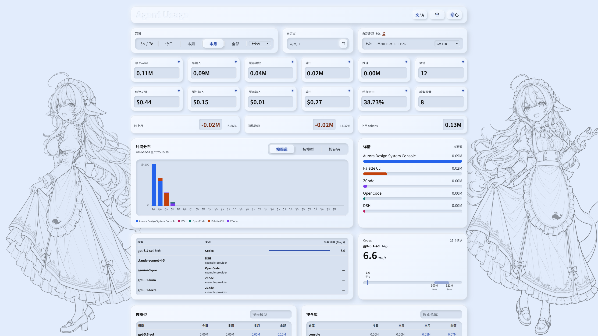
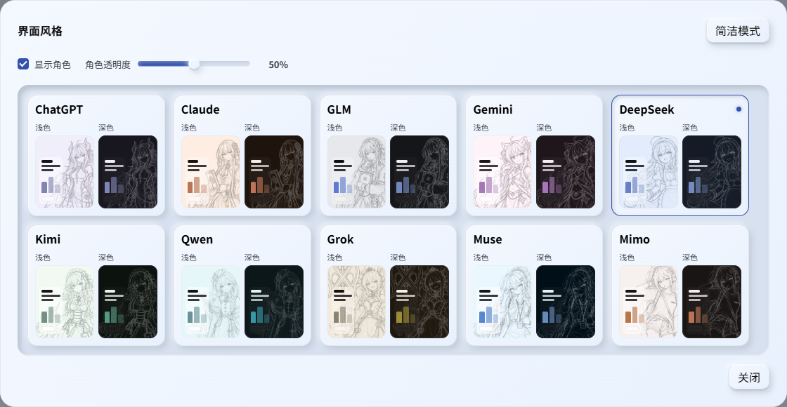

# Agent Usage

[简体中文](README.md) · English

Agent Usage is a local dashboard for Codex, ZCode, DSH, OpenCode, Claude Code, and WorkBuddy usage. It reads existing session and usage records to show tokens, cache hits, sessions, and estimated API equivalent costs by time, source, model, and repository. Your logs stay on your computer.

This project builds on [DhWU-coder/codex-usage](https://github.com/DhWU-coder/codex-usage).

Current release: [v0.7.0](https://github.com/Sylva1027/codex-usage/releases/tag/v0.7.0).



## Quick Start

Requires **Node.js 23.8 or later**; check with `node -v`. Download and extract the repository ZIP, or run:

```bash
git clone https://github.com/Sylva1027/codex-usage.git
cd codex-usage
node src/cli.js run
```

Open [http://127.0.0.1:3765/](http://127.0.0.1:3765/). The server binds to `127.0.0.1` by default. Press `Ctrl+C` to stop it. No npm dependencies need to be installed. On Windows PowerShell, the `node` command above also avoids `npm.ps1` execution policy errors.

## Dashboard

- **Time and Trends:** Explore Today, This Week, This Month, All Time, custom dates, and recent ranges. View the timeline by source, model, or estimated cost. Longer All Time, custom, and recent ranges automatically merge daily bars into weekly or monthly bars; the subtitle and tooltips show the grouping and covered dates. This Week follows the calendar week.
- **Recent Ranges:** Last 5h and Last 7d run from the actual start of the preceding respective allowance to the actual start of its replacement, so they may span less or more than five hours or seven days. Expiry alone does not replace a cycle. Last Month is the previous full calendar month; This Year runs from January 1 through today.
- **Codex Limits:** The `5h / week` control switches between the current five-hour and weekly limit windows. These limit ranges, Last 5h, and Last 7d count Codex sources only; ordinary ranges such as Today, This Week, and This Month still count all selected sources. Boundaries come from local Codex limit observations. The current five-hour chart uses 30-minute slots and the current weekly chart uses consecutive 24-hour slots. Last 5h shows only half-hour slots with usage, clipping the final slot at the replacement start. Last 7d shows only calendar dates with usage. Both retain the complete timestamps and duration. The dashboard does not guess missing boundaries. With no Codex source selected, the limit control and the corresponding recent range options are disabled.
- **Usage and Costs:** Inspect Total Input, Cache Hit, Cache Miss, Output, Reasoning Tokens, and Cache Hit Rate. Compare usage by source, model, and Git repository; search and sort the details. Usage tables show model names in lowercase, while aggregation and pricing retain their original model keys; the speed area keeps original names. Cache-hit and cache-miss input use separate pricing rates. Ordinary ranges group subagents and execution channels under Codex, ZCode, DSH, OpenCode, Claude, and WorkBuddy; Codex-only limit ranges retain channel detail. Local Git repositories appear first, followed by the selected period sort.
- **Model Speed:** A separate area ranks models by average output speed, keeping the original model name and reasoning effort distinct and separating Codex, DSH, OpenCode, ZCode, WorkBuddy, and Claude. Select a row for its average, sample count, and p10–p90 range. It uses the existing time, source, and frozen-snapshot controls. Claude durations come from transcript timestamps (request end-to-end, including request wait and TTFT); only requests immediately following a prompt/attachment row are timed, and same-turn continuations are not sampled. TPS output is 0.0137% below the event-path output total. WorkBuddy durations come from the explicit `duration` on generation spans in its traces.
- **Records and Comparisons:** Applicable ranges can highlight new highs and compare them with a preceding period. All Time has no preceding period and shows no New Record badges.
- **Sources and Refresh:** Codex, ZCode, DSH, OpenCode, Claude Code, and WorkBuddy data are discovered locally. You can import another Codex, ZCode, or DSH directory, an OpenCode data directory, a Claude Code home, a WorkBuddy home, or a project with `.codex-usage/usage.jsonl`. Choose which sources count in the Edit dialog. Add sources through Scan Directories. The page checks for new records every 60 seconds by default, showing a spinner beside the switch during checks. Failed loads retry on the next check, and error details open inside the existing refresh frame. Pausing auto refresh keeps the data snapshot fixed while you change ranges.
- **Language and Theme:** The **文/A** button beside the theme control switches between Simplified Chinese and English. The first visit follows your browser's preferred language, and a manual choice is remembered. Light and dark themes are available. The shirt icon opens **Waifu**, offering ChatGPT, Claude, DeepSeek, Kimi, and Muse skins plus Simple mode, with updated palettes across the dashboard. Light and dark thumbnails appear side by side; desktop shows all five in one row, with a glowing dot marking the selection. Character visibility, opacity, and your skin choice are remembered.



## Data Sources and Privacy

Codex usage comes from session logs in homes such as `~/.codex`; ZCode defaults to `~/.zcode/cli/db/db.sqlite`; DSH (DeepSeek Harness) uses `~/.dsh/sessions`; OpenCode uses `opencode*.db` in its data directory, such as `~/.local/share/opencode`; Claude Code uses session transcripts under `~/.claude/projects` (including `subagents`, deduplicated by `message.id`); WorkBuddy uses session records under `~/.workbuddy-ai/projects` (deduplicated by `providerData.messageId`, with `model=default-model` Auto records excluded entirely), and response durations come from generation spans in `traces/<pid>` in the same directory. Requests absent from these records or an imported project log do not appear in the dashboard.

Adapters extract usage and necessary metadata without including message content in statistical events. SQLite databases are opened read-only first; the current fallback uses a regular open and can trigger recovery or auxiliary file operations. The app does not intentionally rewrite upstream business records. See the [data-source reference](docs/10-data-sources.md) for formats, imports, and read boundaries.

- `CODEX_USAGE_ZCODE_HOMES`: Add ZCode data directories. Separate paths with the system path separator (`;` on Windows, `:` on macOS/Linux).
- `CODEX_USAGE_ZCODE=0`: Disable automatic ZCode discovery.
- `CODEX_USAGE_DSH_HOMES`: Add DSH data directories, using the same path separator.
- `CODEX_USAGE_DSH=0`: Disable automatic DSH discovery.
- `CODEX_USAGE_OPENCODE_HOMES`: Add OpenCode data directories, using the same path separator.
- `CODEX_USAGE_OPENCODE=0`: Disable automatic OpenCode discovery.
- `CODEX_USAGE_CLAUDE_HOMES`: Add Claude Code homes, using the same path separator (`CLAUDE_CONFIG_DIR` is discovered automatically).
- `CODEX_USAGE_CLAUDE=0`: Disable automatic Claude Code discovery.
- `CODEX_USAGE_WORKBUDDY_HOMES`: Add WorkBuddy homes, using the same path separator.
- `CODEX_USAGE_WORKBUDDY=0`: Disable automatic WorkBuddy discovery.

Codex, ZCode, DSH, OpenCode, Claude Code, and WorkBuddy all count toward ordinary ranges. The **5-hour and weekly limit windows measure Codex usage only**; the other sources have no limit records and never take part in them.

`codex-auto-review` has zero cost under the [official free policy](https://help.openai.com/en/articles/11369540-using-codex-with-your-chatgpt-plan) and is excluded from current and previous limit windows. Ordinary ranges retain its actual tokens and activity. Stale manual rates cannot override this exemption.

An incremental SQLite index stays on your computer at `~/.codex-usage/usage-index.sqlite` by default. Subsequent scans process only changed files.

## Cost Estimates

The dashboard estimates **API equivalent costs, not actual bills or subscription limit charges**. You can inspect and edit model rates in the dashboard. Pricing distinguishes cache-miss input, cache-hit input, cache writes, and output, plus long-context and Fast/Priority rates where applicable. When a record lacks required details, the page identifies tokens estimated at the lowest applicable rate and tokens that cannot be priced.

Claude usage in existing sources supports 17 built-in versions, official dated snapshots, and Anthropic price updates. Cache writes use an explicit 5-minute scenario with a caveat when TTL is missing; known unsupported TTLs retain unpriced writes. Uncatalogued older versions remain marked as missing, and ZCode's cache/input relationship still needs upstream evidence.

The local dashboard checks public model rates and USD/CNY exchange rates, normally every 24 hours, retrying an hour after a failure. Existing sources include Models.dev, LiteLLM, and official StepFun, MiMo, Kimi, and GLM pages. New model discovery currently requires complete evidence for an OpenAI USD text model. Models in Use includes only models seen within the last rolling calendar month; older models remain available under All Models for historical pricing. Missing models remain visible; uncatalogued `-free` models use the free rule, while other missing rates retain minimum-estimate labels.

Automatic results live in `~/.codex-usage/pricing-auto.json`; manual changes live in `~/.codex-usage/pricing.json` and take precedence over rates, except for official billing exemptions. Offline use falls back to cached or built-in values. Public price requests do not upload local usage or model names. Amounts retain their original currency, with an adjustable rate for mixed-currency charts. See the [pricing reference](docs/11-pricing.md) for matching, source limits, and overrides. Provider rates can change; verify the source links in the active catalog.

## Commands

```bash
node src/cli.js summary       # Terminal summary
node src/cli.js summary --json
node --test                   # Run tests (run npm ci first for devDependencies)
```

A copy unpacked from the GitHub source archive can run the tests too: dated acceptance screenshots and authoring source images are not distributed with it, so the 14 tests that read them skip explicitly while everything else runs. See [running the tests](docs/03-development.md#怎么跑测试).

## Documentation and Development

- [Documentation index](docs/00-index.md): roadmap, tasks, current references, validation, and archives.
- [Dashboard behavior](docs/12-dashboard.md): ranges, sorting, refresh, dialogs, languages, and themes.
- [Project-log integration](docs/14-project-log.md): produce importable records using real token usage.
- [Development and handoff](docs/03-development.md): code locations, environment, and checks.

Detailed references are maintained in Simplified Chinese. Licensed under the [MIT License](LICENSE).
