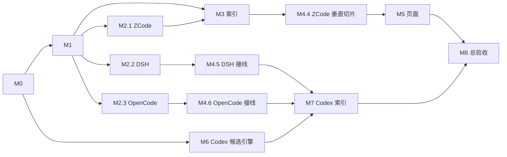

# 模型输出吞吐（TPS）：Implementation Plan

**2026-10-08 界面后续任务：** 用户已否决原 M5 呈现并选择独立模型吞吐区域；按[前端重构方案](2026-10-08-tps-ui-restructure.md)审阅原型后实施。以下 37 卡与 G4 结论保留原受测版本的历史归属，不作为新界面设计接受或新版本测试的证明。

更新：2026-10-08。状态：**实施完成，37张卡收口，M8 / TPS G4通过最终独立审核**，见[主审裁定](../validation/2026-10-04-perf-metrics/20261004T035100/handoffs/M8.3-G4-主审最终复核-20261008.md)。本计划原地标完成，保留施工契约、原顺序与历史证据；正文的待执行表述不自动恢复为当前任务。

本文件把[现行 TPS 方案](2026-10-03-model-latency-throughput-plan.md)拆成可交接的工程任务。方案的 §3–§5、§7–§11、§17 是指标与行为契约；本文固定施工接口、文件归属、依赖和验收。若探测到上游格式与方案冲突，执行者记录 `CONTRACT_CONFLICT`，先交由集成者修订契约和 fixture，再继续受影响的来源；不得在适配器里悄悄改口径。[M0.1 交接样例](../validation/2026-10-03-skin-palette-redesign/20261003T185748/handoffs/archive/2026-10-05/M0.1.md)仅供报告格式参考，与 TPS 产品决策无关。

## 1. 执行边界

本计划共 **9 个模块、37 张小任务卡**。一个执行 agent 一次领取一张卡，完成该卡的代码、针对性检查和 `handoffs/Mx.y.md` 后才领取下一卡；同模块可以换执行者。每个模块另由集成者写 `handoffs/Mx.md`，逐条核验卡片产物、依赖和证据。模块报告不能由简单拼接子报告代替。所有模块报告交给最终审核者复核；最终审核者应实际读 diff、跑适用检查并抽查证据，不能只看 `DONE` 字样。用户后续可以把这批报告交回本会话审核。

全程遵守以下边界：

- 只用历史记录；四源目标为 ZCode、DSH、OpenCode、Codex。**不实现 TTFT**，也不从消息正文推算 token。Codex 只称“轮级 item 时窗 TPS 估算”。
- `timingKind`、`tokenScope`、provider、effort 和来源实例是分组身份，不跨口径合并。固定 fixture 校验公式和剔除；本机 2026-10-03 样本数、p50、覆盖率不当验收常量。
- 上游库的新增 TPS 读取必须严格只读。`src/zcode-usage.js` 与 `src/opencode-usage.js` 的既有可写兜底不能被新路径调用；只读失败记来源退化，不修复上游库。
- `perf_samples` 只保存元数据和整数计数，不保存回复、推理正文、工具参数、工具结果、`item_json`。DSH/JSONL 解压解析时内容可能进入内存，但产物、日志、报告中不带正文或原始会话 ID/路径。
- 保留其他任务的未提交改动；开始和结束记录相关文件的工作区 SHA-256。不得用 `git reset/checkout/clean` 整理共享工作区，不自动提交、推送或发布。任务卡指定文件以外的修改先由集成者调整所有权。
- 一文件同一时刻只有一个写入者。并行 agent 只在独立文件和已冻结的公共契约上工作；`usage-store.js`、`usage-core.js`、`server.js`、`app.js` 的接线由指定集成者串行完成。

## 2. 模块、卡片与可并行窗口

| 模块 | 卡片 | 产物 | 前置屏障 |
| --- | --- | --- | --- |
| [M0 证据与冻结契约](2026-10-04-model-tps-implementation/M0-evidence-and-contract.md) | M0.1–M0.6 | 源码/工作区基线、四源有界探测、字段决议、fixture 清单 | M0.2–M0.5 可在 M0.1 后并行 |
| [M1 统计内核](2026-10-04-model-tps-implementation/M1-kernel.md) | M1.1–M1.3 | 身份/flag、合格判定、覆盖率、分位与总量比 | M0.6 |
| [M2 来源提取](2026-10-04-model-tps-implementation/M2-source-readers.md) | M2.1–M2.3 | 三个互不抢文件的只读来源 reader | M1.1；三卡可并行 |
| [M3 索引](2026-10-04-model-tps-implementation/M3-index.md) | M3.1–M3.4 | v12 候选表、替换失效、查询与重建状态 | M1.1；M3.1 可与 M2 并行，M3.2 等 M2.1 |
| [M4 汇总、API 与三源接线](2026-10-04-model-tps-implementation/M4-summary-and-api.md) | M4.1–M4.6 | 内存/SQLite 两路径、两个 API、冻结快照、ZCode→DSH→OpenCode 接入 | M1.3、M3.3；M4.1 可提前与 M3 并行准备 |
| [M5 页面](2026-10-04-model-tps-implementation/M5-ui.md) | M5.1–M5.4 | 性能模式、覆盖率/排名、i18n/无障碍和浏览器证据 | M1.3 API 形状；M5.1 可与 M3/M4 并行，M5.3 等 M4.4，M5.4 等 M4.6 |
| [M6 Codex 候选引擎](2026-10-04-model-tps-implementation/M6-codex-reader.md) | M6.1–M6.4 | JSONL 复合身份、模型/终态、跨 rollout 轮候选、可选补缺决议 | M0.5、M1.1；可与 M3–M5 独立进行 |
| [M7 Codex 索引与交付](2026-10-04-model-tps-implementation/M7-codex-integration.md) | M7.1–M7.4 | 依赖表、线程重建、估算 API/UI 与回归 | M4.6、M6.4；依次串行写共享文件 |
| [M8 验收与文档](2026-10-04-model-tps-implementation/M8-acceptance.md) | M8.1–M8.3 | 固定 fixture/真源复核、页面验收、长期文档与总审计 | M5.4、M7.4 |

先做 M0.6 冻结契约。之后可同时派 M1 与 M3.1 的 schema 草稿，以及 M2 的来源调查草稿；M2 标 `DONE` 须基于 M1.1 的正式样本接口。**首个产品屏障是 M4.4 + M5.3 的 ZCode 垂直切片**，然后 M4.5/M4.6 分别接 DSH/OpenCode；M6 可同期做纯解析，M7 等三源共享链路稳定后再改索引。若只有 2–3 个 agent，优先给 M1、ZCode、M3 各一位；DSH/OpenCode/Codex 不占用这些共享文件。



现行方案 §10 的 P 卡只是阶段摘要，对应关系固定：`P0.1→M0.1–M0.5`，`P0.2→M0.6`，`P1.1→M1`，`P1.2→M3`，`P1.3→M2.1+M4.1`，`P1.4→M4.2–M4.4`，`P1.5→M5`，`P2→M2.2+M4.5`，`P3→M2.3+M4.6`，`P4.0→M7.1–M7.3`，`P4.1→M6.1–M6.3`，`P4.2→M6.4（有证据才启用）`，`P4.3→M7.4`，`P5→M8`。执行时不要把 P 卡再作为一份平行任务发下去。

## 3. 固定文件所有权与接口

新增文件固定为 `src/perf-stats.js`（M1）、`src/perf-sources/{zcode,dsh,opencode,codex}.js`（各来源卡）、`src/perf-sources/index.js`（M3/M4 集成者），以及对应 `test/perf-*.test.js`。M0 的探测只写 `scripts/perf-probe.mjs`、`scripts/perf-probe-sources/` 和本次 validation，并限 M0.1 把这些脚本及将由 M4.4 创建的 `test-support/perf-fixture.mjs` 纳入 `biome.json`；M5 可新增 `public/perf-ui.js` 作为纯展示模块。集成 fixture 在 M4.4 建 ZCode，M4.5/M4.6/M7.4 依次扩充，M8 复用。`src/usage-types.js` 归 M1.1；`src/usage-store.js` 归 M3，M7 获得 M3 模块出口后接管；`src/usage-core.js / server.js / cli.js` 归 M4，M7 再接管 Codex 分支；`public/app-state.js / app.js / index.html / styles.css / i18n.js` 归 M5，M7 只能由同一 UI 所有者补 Codex 标签。`package.json`、导航和长期专题归 M8。既有来源适配器若必须改，先在模块报告写明原因和最小行段，交所有者串行处理。

调用接口在 M1.1 固定：

```js
// 每个 reader 只读一个已发现的物理文件，候选按稳定 sampleKey 输出。
streamZcodePerfSamples(filePath, source, onSample, { onWarning })
streamDshPerfSamples(filePath, source, onSample, { onWarning })
streamOpencodePerfSamples(filePath, source, onSample, { onWarning })
// Codex 是同线程多文件聚合，不能套单文件候选 API。
buildCodexThreadPerfSamples({ homeId, threadId, rolloutFiles, onWarning })

// M3/M4 唯一调度入口；未启用来源返回 unsupported 状态，不伪造 0 TPS。
streamPerfSamplesForFile(filePath, source, onSample, { onWarning })

// M1 唯一统计入口；SQL 只取原始整数，不自行算分位或 TPS。
summarizePerf(samples, { range, excludedHomeIds, knownSources, meta })
```

`PerfSample` 的 JS 键用 camelCase、SQLite 列用方案 §4 的 snake_case；两者一一映射。必有 `sampleKey/sourcePath/sourceKind/homeId/channel/agentKind/agent/sessionId/turnKey/model/modelProvider/reasoningEffort/modelEvidence/window/timingKind/timingSource/tokenScope/status/tsMs/windowStartMs/windowEndMs/durationMs/outputTokens/inputTokens/requestCount/itemCount/timedItemCount/sampleFlags/diagnosticReason/methodVersion`。未知数值为 `null`，真 0 为 0；未知名称为空串，未知身份用 `agentKind='unknown'`，不得用 `main` 补缺。`sampleKey` 用 JSON 数组序列化规范身份元组（方案 §17.1），不拼接未转义分隔符。**无法形成稳定身份的坏原始行不写表**，只增加已编码 `sourceWarnings` 计数；它不进入可去重的 `eligible`，页面不得据此宣称源全覆盖。

`summary.perf = { groups, coverage, meta }`。`groups` 只含 `sampled > 0` 的统计组，至少具有方案 §5 的维度、`n`、`tps.p10/p50/p90/pooled`、`durationMs.p50/p90` 与两个整数和；`coverage.bySource/byGroup` 采用 §17.5 的计数形状。`meta` 至少有 `methodVersion='tps-v1'`、`state=rebuilding|ready|degraded`、`indexVersion`（本次已发布来源指纹）、`indexedAt`、`minSamples=20`、`longWindowMs=300000`、`eraCutoffMs` 和只含 `sourceKind/homeId/code/count` 的 `sourceWarnings`。API/CLI 公开输出只含统计与现有公开 report 字段，不返回内部 `perfSamples/sampleKey/sourcePath` 或原始线程 ID；`codex-usage json` 的直接 `JSON.stringify({report,summary})` 必须在 M4.3 先投影公开 report。两个生产汇总路径用同一个 `summarizePerf`；允许 `indexedAt` 等运行时间不同，**样本集合、统计、覆盖率、方法版本必须一致**。

`sourceWarnings.code` 至少固定 `UNKEYABLE_RECORD / READ_ONLY_OPEN_FAILED / UNSUPPORTED_SCHEMA / MALFORMED_JSON / MALFORMED_FRAME / LIVE_SOURCE_CHANGED / OPTIONAL_SOURCE_UNAVAILABLE / AGGREGATE_OVERFLOW`；来源终态/版本细项由 M0.6 在 `source-contract.md` 冻结。读库错误只转编码原因和数量，绝不把异常的原始 message、SQL 路径或 session ID 写入 API/validation。新增 code 须先更新契约与测试，再由 reader 使用。

范围规则固定：样本 `tsMs` 归属当前 `resolveDateRange` 的范围，普通 end 为现行包含边界；限额窗口使用 `windowEndExclusive` 的排他边界。`excludedHomeIds` 包含用户排除的来源；限额范围还排除非 Codex 来源，沿用现有来源资格。`tsMs=null` 只进全历史 `unplaced` 诊断，不进当前范围 `eligible`。`crossPeriod` 仅查询时根据完整观测边界说明，不写持久 flag。序列化/读取时检查 Number 安全整数，非法或求和溢出产生诊断，不输出伪 TPS。

## 4. 每张卡的交接与模块报告

验证目录为 `docs/validation/<运行日期>-perf-metrics/<runId>/`。由协调者先建立本次 `run.json`，记 Git HEAD、dirty 文件列表、相关文件工作区 SHA-256、Node/OS、源指纹和已分配文件所有者；每张卡只写自己的 `handoffs/Mx.y.md` 与专属证据。真实源探测只保存聚合计数、脱敏指纹、版本和方法，禁止保存会话路径、原始 ID、正文或工具内容。与该 run 不同的源/代码摘要必须注明，不可混作一次验收。

`handoffs/Mx.y.md` 按以下字段填写，可直接复制[单卡与模块报告模板](2026-10-04-model-tps-implementation/handoff-template.md)；缺一项标 `NEEDS_REVIEW`：

1. 任务号、状态 `DONE/NEEDS_REVIEW/BLOCKED`、前置任务及其摘要、运行目录和卡片链接。
2. 允许文件、实际改动文件、开始/结束 SHA-256；新增文件写“无开始值”，共享文件写冲突核对结果。
3. 实现接口与关键行为，逐条映射本卡验收；来源口径附字段证据与脱敏输入指纹。
4. 实际运行的命令、退出码、测试数量或断言、日志/fixture/截图路径。未运行项与原因单列，不写“应当通过”。
5. 偏离契约、失败/退化、并行冲突、未测边界、下张卡所需输入；没有问题也写“无”。

模块集成者在全部卡验收后写 `handoffs/Mx.md`：列每张卡状态与链接、归属文件最终摘要、接口兼容核对、跨卡测试实际结果、仍未闭环的风险、向下一模块移交的固定对象。集成者检查源码/测试/SQL/页面，而非把子报告的 `DONE` 机械复制。最终审核者对每个模块抽查至少一条核心成功路径和一条失败路径；M3/M4/M7 的迁移、冻结和跨文件失效须完整复核。未审模块不得被后续报告称为已验证。

## 5. 发布屏障与降级

- **G0 契约**：M0.6 的字段/版本/身份/终态决议和合成 fixture 清单已冻结；单源待核实只阻塞该源。探测不能把上游变动的本机样本数写进断言。
- **G1 ZCode 切片**：M1、M2.1、M3、M4.1–M4.4、M5.1–M5.3 完成。真实 ZCode 的来源/代理/模型组在页面显示 p50 与 n；两汇总路径、两个 API、冻结与覆盖率在固定 fixture 一致。
- **G2 三源**：M2.2/M2.3、M4.5/M4.6、M5.4 完成。DSH 只用 message−step.start，OpenCode 只用 v2 created→completed；三源请求端到端口径标签可见。
- **G3 Codex**：M6/M7 完成。JSONL 跨 rollout 轮只在完整、终态可信、模型不冲突时统计；partial/旧时段缺时窗留诊断；Codex 不混入请求端到端排名池。P0 证明无可靠附加 SQLite 收益时，M6.4 可以以“不启用”报告关闭，不阻塞 JSONL 路径。
- **G4 总验收**：M8 报告真实执行的 `npm.cmd test`、`npm.cmd run typecheck`、`npm.cmd run lint`、`npm.cmd run format:check`、隔离浏览器检查与日期来源复核；仅其受测快照可声称验收。某来源失败可单独 `degraded`，不能把部分结果标为全源 `ready`。

`rebuilding` 时页面显示重建状态，不展示部分索引作为已完成排名；sync 结束后才发布 `indexVersion/indexedAt`。无法只读打开、字段变更、坏帧和跨文件不完整均走带编码原因的来源退化。执行者不得用任意时长、0、上一次模型或当前设置补足缺失证据。
