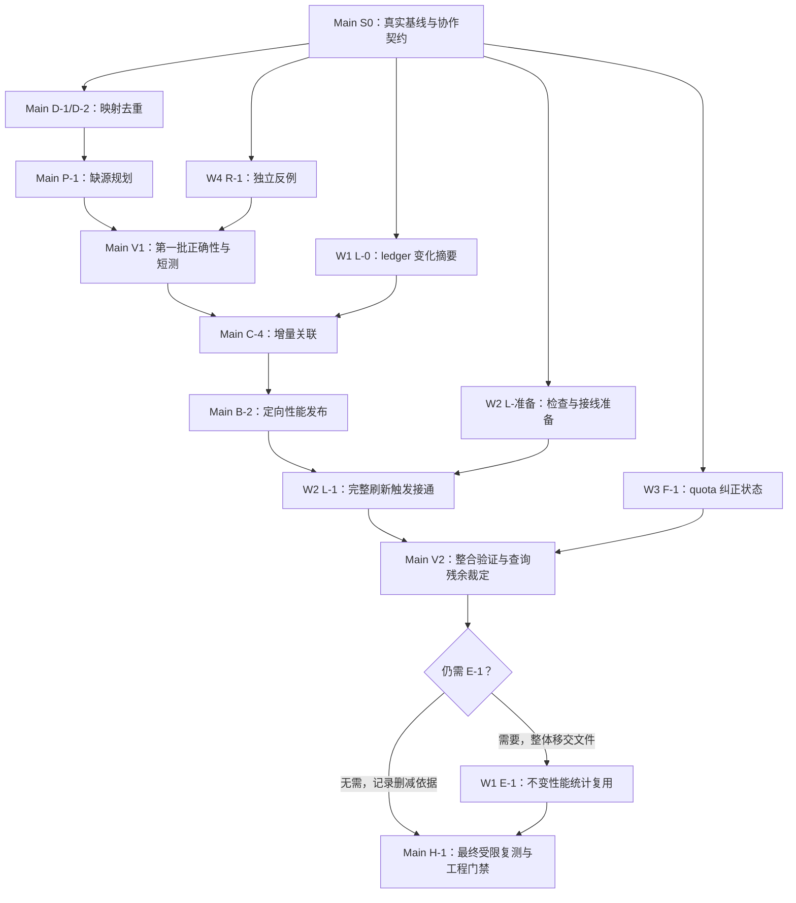

# 自动刷新同步延迟治理方案

日期：2026-10-26，收口：2026-10-27。修订：**v6，入选范围已按主审 + 4 个原生 subagent 实施并完成评估；延迟目标部分未达。** v3 的诊断依据保留，本轮未切换生产服务。最终结果见 **§16** 与[实施验收](../validation/2026-10-26-refresh-sync-latency-implementation/README.md)；§9 保留实际分卡、整文件单写和单测试槽规则。旧[复测报告](../validation/2026-10-26-refresh-sync-latency-reeval/README.md)只代表实施前诊断。

用户已决定：**历史保留完成后，先完成复测和评估，再修订 plan；先交付剩余瓶颈与建议实施范围，不动产品代码。** 随后用户“开工”授权按 §9 实施建议范围；保留生产迁移/重启、提交/推送的非目标边界。

用户随后要求把计划改为适合当前多 subagent 并行。这里采用本会话原生 subagent 协作，默认继承主模型；不沿用其它项目阶段的 DeepSeek 锁定、旧 worker 身份或独立 chat 派工。§9 的角色已按完整文件所有权派发，模型继承当前会话；完成后由 Main 独立接受。

本文区分原报告历史测量、本次独立复测与仍待验证的解释。优先顺序调整为：**修正缺源保留的重复规划 + 映射复制 → Magpie 增量关联/定向发布与 ledger 触发 → quota 纠正分支的小范围 busy 修正 → 按残余处理查询 → 必要时再研究存证或读侧架构**。不预先承诺“14.8 s 降到 6 s”，也不以快速返回旧数据证明刷新已经修好。

本次关键证据：20 轮无变化 sync 的 p50/p95/max 为 **7.34/8.49/8.93 s**；每轮仍因 6 条保留的缺失路径触发 Codex home 规划，读取 **2.80 GB** 前缀，并复制约 **570 万**映射条目。20 个真实 60 s 浏览器周期分两组完成，12 个 token 增量均精确对上，检查到目标 DOM/双 rAF 边界 **8.90–21.14 s**；普通路径未见数秒空窗，受控 quota 纠正分支有 **0.80 s** 的提前结束 busy。每组样本数与分支条件见报告，不据混合场景宣称最终 p95 验收通过。整树 Job 限制 **7 GiB**，另留约 1 GiB 控制余量。

---

## 1. 用户报告与证据状态

用户原话（2026-10-26）：

> 自动刷新框体中代表加载中的圆圈，它转动的时间变得极长，普通的每分钟刷新都动不动能转十几秒甚至更久。而且转圈消失之后新增的数据变化也并不是立刻就出现的，还可能再次延迟数秒-10 秒才发生变化……我担忧有隐患让这个程序进入无限的加载循环……用户体验糟糕这一件事也足够给这个项目判死刑了。

| 编号 | 主张 | 本次修订后的证据状态 |
|---|---|---|
| C1 | 自动刷新转圈可达十几秒 | 独立复测的 12 个新增 token 场景，检查到目标帧 8.90–21.14 s；不是全部普通分钟周期的分布 |
| C2 | 普通的每分钟刷新频繁出现长等待 | 有变化时长等待已复现；4 个静止周期只做快速 status。生产中发生频率未抽样，不能说静止周期也总会完整同步 |
| C3 | 转圈消失后数据再延迟数秒–10 秒 | 普通新增值样本同帧；受控 metadata 变化触发 quota 纠正后有 0.80 s 空窗。自然触发频率及数秒–10 秒幅度仍未复现 |
| C4 | 存在无限加载循环的隐患 | 20 个周期均完成且无浏览器错误；静态已有重入保护和有界重试。未覆盖任意网络/执行器故障，不能排除全部悬挂 |

验收同时关注真实新数据的可见时间、用户等待时间与后台计算成本，不能只看 spinner。指标定义见 §6。

---

## 2. 历史测量与后续复跑方法

### 2.1 原诊断基线（2026-10-26 历史快照）

以下数字沿用原报告，**不是本轮新增测量，也不是后续实施的固定基线**：

- 分支 `feat/claude-code-tps`，HEAD `b84885a`；当时报告 64 个已修改文件（+14,523 / −3,296）。后续必须重新记录真实工作树，不能用 HEAD 或旧隔离副本替代未提交代码。
- 原报告记录在线进程启动于 2026-10-25 03:50，未将其受测源码摘要与当前工作树绑定；在线数字仅作当时体感参照。
- 索引库 `~/.codex-usage/usage-index.sqlite` 569.9 MB，`-wal` 0 B、`-shm` 288 KB。这是单次状态，不能证明长期 WAL 或内存稳定。
- `~/.codex/sessions` 796 MB / 1,098 文件；`perf_codex_projections` 129 MB / 1,258 行，`perf_rollout_threads` 1,261 行，`history_replaced_facts` 218 MB。
- 原报告称探针运行于 Windows 11 的隔离副本 `E:/tmp/cu-profile*`。本轮未在计划预留的证据目录核验原始脚本、日志与完整样本；临时路径本身不构成可持续引用的证据。

### 2.2 在线服务历史测量

原报告记录：

- `/api/status`（无 `since`）约 0.02–0.05 s。
- `/api/usage`（默认检查）20–50 s。
- `/api/usage?skipCheck=1` 约 0.45–3.3 s。

这些样本提示同步可能是主要成本，但参数、预热、输入和受测代码未统一，不能据此精确计算同步净耗时或统一的提速倍数。

### 2.3 隔离轮次历史探针

原报告记录一次 `UsageStore.sync()`：

```text
syncRound#1        7,049 ms   updatedFileCount=3
importMagpie       2,357 ms   changed=true
syncRound#2        5,396 ms   updatedFileCount=0
total             14,803 ms
```

这是一条值得优先复核的线索：第二轮文件更新计数为 0，却仍有大量耗时。**该计数只描述文件更新，不证明性能证据、发布状态或其他表完全未变。** 要确认哪些工作可省，应同时记录规划、折叠、读字节、事务与发布次数。单次 14.8 s 不能写成 p95；各阶段显示值与总数的毫秒尾差沿用原记录。

### 2.4 浏览器历史时序

原报告监听 spinner class、网络响应与首个指标 DOM 变更，记录：

| 事件 | 原报告记录 |
|---|---|
| 自动刷新 tick | spinner 加 `is-loading` |
| `/api/status` 返回 | 约 +0.1 s，`changed:true` |
| `/api/usage` 返回 | 约 +13.6 s，spinner 关闭，指标同帧更新 |
| 另一轮 / 首屏 | 16.3 s / 26 s |

该样本支持长等待主要发生在响应返回前；它**没有证明 C3 的数秒空窗**。样本不足以给出“回归系数接近 1”或“每分钟都如此”的统计结论。DOM 修改时间也不能直接替代实际绘制时间。

### 2.5 查询侧历史分档

原报告对后端 `dashboard()`（不含同步）的记录：

| preset | 原报告耗时 |
|---|---|
| 今天 / 本周 | 0.45 s |
| 本月 | 2.1–2.3 s |
| 全部 | 3.2–3.3 s |

**这是服务端查询耗时，不是浏览器 `render()` 耗时。** 后续分别测同步、查询、传输/解码、DOM 更新和绘制，不能跨阶段套用数字。

### 2.6 复跑方法（本轮已按隔离范围执行）

1. 历史保留完成后，冻结受测工作树、来源与 ledger，记录源码 SHA-256、Node 版本、进程启动时间、库与来源规模。活动来源另开一组测，不混入冻结输入的 A/B。
2. 按历史保留已验收的方法取得一致性库副本；不得把活动库的 `.sqlite` 与 `-wal` 分别复制后直接当成一致快照。所有会写库的探针只用自己的隔离副本。
3. 以该工作树启动新隔离实例。无需为建立基线重启正式服务；后续正式切换另行安排。
4. 同一输入、参数与预热条件下测默认刷新、`skipCheck=1`、`sync()`、`dashboard()`，同时记录 `syncRound`/发现/规划/折叠/提交次数与实际读取字节。包装器保持原方法同步或异步的契约。
5. 浏览器记录检查开始、网络完成、预置纠正与第二次请求、spinner、DOM、绘制及“本次新增数据确实出现”的时间。用可识别的夹具新增值关联一次刷新，不能只观察任意数字变化。
6. 留存脱敏脚本、原始样本、受测摘要和机器负载；统计方法与场景见 §10。本次证据见[复测报告](../validation/2026-10-26-refresh-sync-latency-reeval/README.md)。没有产品 after 版本，未执行优化效果 A/B。

### 2.7 与上次优化的关系

[上次验收记录](../validation/2026-10-09-refresh-performance-fix/2026-10-09T0525+0800/handoffs/W4-b1.md)记录固定输入的今日默认刷新 p50 从 2,712.8 ms 降到 1,790.7 ms，仍未达到当时的全部延迟目标。当前代码相较当次验收副本，又包含全文前缀存证与 Magpie 导入路径。

因此，当前卡顿的候选机制包括**旧热点残留、历史增长、新增计算成本**。不能用不同时间、不同数据集的绝对耗时直接量化回归比例，也不能把问题全部归于数据变大。

---

## 3. 代码已确认的成本与待验证归因

### R0｜已确认：缺源保留与路径集合判据反复触发规划

`syncRound()` 用全部保留的 Codex source_files 构造 oldPaths，与实时 expectedPaths 比较。本次 1,394 条旧路径中 6 条已缺失但仍保留 14,416 events / 359 perf_samples；暖态 pathSetChanged 始终为 true，而其它规划原因均为 false。导致每轮进入 planStableCodexHome，完整前缀读取 2,803,376,137 bytes。

新增 P-1：稳定缺失不再被当作新的集合变化；真实缺失、回归、重命名/替换仍须正确触发重规划，保留事实与证据不删。先处理触发判据，不先设计分块/Merkle 存证。这里确认的是当前组合的残余行为，不据此断言它由某个历史保留提交引入。

### R1｜普通刷新请求仍等待同步

[前端](../../public/app.js)的 `checkForUpdates()` 在 `status.changed` 或 quota 预置下调用 `loadUsage()`，默认不带 `skipCheck`；[服务端](../../src/server.js)的普通 live 路径等待 `loadUsageStore({check:true})`，然后执行 dashboard。

已有同步由 `syncPromise` 合并；这不等于每个并发请求都新建一轮同步。等待完整同步流程也不等于所有历史文件都重新全文解析。默认 today 的 3 个暖 HTTP 样本为 9.27–10.50 s，skipCheck 为 0.56–0.67 s；先减少同步成本，不由该差额直接推出要改协议。

### R2｜Magpie 导入可能触发第二轮完整同步

[UsageStore.sync()](../../src/usage-store.js)当前的关键顺序为：

```js
let status = await this.syncRound(args);
if (await this.importMagpieRequestTimings(timingWarnings)) status = await this.syncRound(args);
```

`importMagpieRequestTimings()` 有 ledger/publication 未变时的跳过条件；进入处理后会读投影、按 home/thread 折叠并映射计时证据。**只有导入返回 changed 才触发第二轮**，不能写成 publication 一变化就必定再跑，或“几乎每轮”已经得到证明。

本次 20 个静止样本均只有一轮、Magpie 检查 p50 0.44 ms；相关增量已复现两轮及约 5.61 GB 前缀读取。变化后的导入本身仍约 1.8–3.0 s，导入前移不会消除这部分；单轮化也必须覆盖本轮刚产生的原生映射，不能造成计时证据晚一周期可见。必要时保留轻量性能发布阶段。

新增 L-1：4 个 ledger-only 周期的 status.changed 均为 false，直到其它来源变化才处理新增计时证据。其触发修正与增量关联/定向发布一起进入，不单独把 ledger 接入完整重同步。

[执行器](../../src/usage-executor.js)在警告全为 Codex `LIVE_SOURCE_CHANGED` 时还会有界地再调用一次 `store.sync()`。按当前分支组合，每次 sync 至多两轮、执行器至多两次调用，静态组合上界可到四轮；条件能否同时触发需夹具验证，不能把最坏情况写死为三轮。这条恢复路径不是可以直接删除的冗余。

### R3｜成本受历史规模与触发范围共同影响

1. **全文前缀存证**：[usage-core.js](../../src/usage-core.js)的 `perfFilePrefixEvidence()` 确实读取当前整个文件。其含义是“相对于后续追加内容的旧前缀”，用于证明追加前的内容未被改写，名称与职责并不矛盾。它在 `planStableCodexHome()` 的读取前窗口采集；store 有 `shouldPlan` 守卫，故不是无条件每轮读全部 Codex 历史。一个 home 需重新规划时，仍可能给其中全部文件付出存证成本，须按触发原因与字节数计量。
2. **映射逐文件复制**：`createPublishedFileMapsView()` 复用了解码结果，但每次 getter 仍展开整份对象。若校验 F 个文件、映射含 M 项，复制成本约为 O(F×M)；两者同步增长时可能接近平方增长，不能统称为线性成本。当前仍有调用者会修改返回副本，修复需保留它们的语义。
3. **Magpie 全量关联与折叠**：进入导入处理后，对符合条件的投影和线程进行遍历，未按本次证据变化限制工作范围。耗时依赖参与处理的历史规模；调用频率和增量边界待测。

本次已确认两个复制阶段合计平均约 1.27 s/静止轮；前缀存证 p50 2.05 s；静止 fold 仅 6 次，已有投影复用有效。字节数是 API 读取量，不是同量 RAM 或物理磁盘 I/O。不得把嵌套折叠、导入和完整 round 相加，也不能相减承诺端到端收益。

### R4｜查询残余需复核已有缓存与 rollup

`buildRecordChampions()` 存在全历史扫描路径，也已有按数据修订、价目、汇率、tier、时区与来源排除集合复用的机制。不能描述成每个请求无条件全历史扫描。历史保留也正在改变汇总与跨冷热读路径；复测时记录命中、失效原因与实际扫描行数，再决定 E 卡范围。

本次已确认 all 暖查询的 timeline 能复用，但 perfSummaryForRange 仍约 0.81–0.98 s；month 另有约 0.55–0.58 s 的分组与约 0.9 s 日线成本。E-1 的具体后续候选是基于已有读修订复用不变性能统计，再按残余处理 month 与更新后的失效；不是先新增通用响应缓存。

### R5｜转圈结束后的延迟尚未定位完整

- `loadUsage()` 的普通成功路径在 `render()` 前关闭 spinner，但两者之间没有 `await`，且 `render()` 是同步函数。仅凭这两行的先后顺序，不能证明存在用户可见的数秒空窗；需要实际绘制/长任务证据。
- `reconcileQuotaSourceSelection()` 改变 preset 后，代码会在本次 render 前再次请求 `loadUsage({skipCheck:true})`。这是潜在等待窗口，但触发条件是来源选择与 quota/recent 预置需要纠正，不能外推为所有自动刷新。
- 本次普通增量未见数秒空窗；受控移除可选 Codex metadata 后，quota → today 第二请求有 0.80 s 的无 busy 等待，F-1 仅建议修该纠正链的完成状态。不是自然生产复现，也不证明数秒–10 秒的反馈已经全面定位。不得先渲染不匹配预置的数据。
- total 的 B 单位两位舍入可能掩盖小增量；程序复测同时核对精确值与输出指标，舍入行为不纳入本轮 UI 改造。

### 3.1 尚不能全面排除的假设

原报告的静止期指纹相等样本只说明当时没有永久失配；来源持续写入也可能正常触发 changed。I/O、GC、机器争用及多请求等待的贡献仍需计时。已有单定时器、重入保护与同步合并应作为基线保留，不因推测先新增调度器或跨标签页通道。

---

## 4. 关于无限加载与周期性重负载

已查路径有 `autoRefreshCheckInFlight`、过期响应丢弃、快照恢复分支和执行器有界重试，**未发现无限重试链**。这不等于对全部挂起、网络中断或执行器超时场景作出了不存在问题的证明。

优先验证重复计算和等待，因为它们有代码依据。后续活跃写入、双标签页与异常恢复样本应记录在途请求、合并次数、CPU、RSS、WAL 和请求落定结果。不能把多个标签页的每个请求都算成独立 sync，也不能用一次长等待直接断言单核满载或无限循环。

---

## 5. 与历史保留计划的关系

以[历史保留实施计划](2026-10-22-history-retention-implementation-plan.md)和[执行账本](../validation/2026-10-22-history-retention/README.md)为准。本次复核已确认 **20/20 完成**，最终门禁按其声明范围通过。生产没有因该交付自动封存或迁移；一致性副本有 0 archive segments，因此本次不是实际冷热淘汰后的对比。

WAL、指纹去重、汇总、冷热读取和发布快照都可能影响本方案的基线、残余成本与正确性边界。**撤回“历史保留技术上不覆盖任一项”和“完成后仍必定十秒”的断言。** 完工后的实际收益与未解决部分必须以新代码、新实例复测确定。

用户要求的等待顺序已满足；复测完成后用户“开工”另行授权了当前实施。store、core、executor、server 与前端按 §9 整文件所有权推进，不恢复旧派工。

---

## 6. 验收指标与目标口径

以下延迟数值为**候选目标，不是已验证可达的承诺**。§15 复测后固定输入规模、负载、预热、样本数与预算，再裁定实施范围；验收不得漏掉慢样本、放慢检查频率或返回旧值来达标。

| 编号 | 指标 | 修订后的判据 |
|---|---|---|
| G1 | 本轮刷新用户等待 | 从检查开始到包含本轮目标新数据的首帧，暖态普通增量候选 p95 ≤ 3 s / max ≤ 8 s；另记 spinner 时长，不能用 class 消失或缓存旧载荷替代完成 |
| G2 | 新数据可见延迟 | 源事件写入 → 对应值可见，候选 ≤ 实际检查周期 + 5 s；同时记录实际周期、排队/节流、同步、查询和绘制时间，不能用配置的 60 s 代替实际周期 |
| G3 | 同步自身成本 | 暖态 sync 候选 p95 ≤ 3 s / max ≤ 8 s；无变化、普通追加、活跃写入、异常恢复分组，单次 14.8 s 不算分位数 |
| G4 | 映射复制与解码 | 逐文件只读校验中整映射复制为 0；每轮两份映射各至多解码一次。写事务所需副本另计，保留提交后更新与回滚隔离 |
| G5 | 前缀存证与读取 | 无需 Codex 重规划的暖轮，前缀存证读取为 0；需规划时按 home/文件/验证窗口记录次数和字节，消除可证明等价的重复读取。取消无依据的“变更字节 + 32 MB”总上限 |
| G6 | 重复同步与发布 | 普通成功路径不因计时富化重复全量发现/规划；允许必要的定向性能发布阶段。异常恢复保留有界重验证并单独计数，不要求所有情形一轮结束 |
| G7 | 资源与长期稳定 | 本次及后续本机测试总预算 ≤8 GiB，测量树 Job 提交内存上限 7 GiB，控制侧留约 1 GiB；heap 不是 RSS 上限。分别记录服务/浏览器与整树口径、稳态/峰值、CPU、WAL 收敛，不再保留未经基线支持的服务 RSS ≤1 GiB 判据，也不以单次 WAL=0 验收长期稳定 |
| G8 | 正确性与发布一致性 | 同一冻结输入、now、价目与上下文的 before/after 业务结果一致；指纹和计时证据发布、失败恢复、冻结/冷热语义均有对拍，细则见 §10.2 |

原 G1 的“转圈 p95 ≤ 0.5 s / max ≤ 1.5 s”撤出整轮刷新验收。后续若单独测缓存命中或刷新触发确认响应，应明确其含义，**不能据此推导 G1/G2/G3 达标**。这些指标独立验收；后台同步更快也不自动证明端到端可见时间达标。

---

## 7. 候选优化与取舍

### 7.1 D｜先消除逐文件整映射复制

与 R0 的 P-1 作为第一批两个独立改动逐项验证；P-1 负责规划触发，D 负责只读热路径复制，不把二者收益混报。

复用已有轮内映射视图，在只读热路径按路径取值，避免为检查一个文件展开整表。保留公共 API 与写事务需要的独立副本，以及成功 COMMIT 后更新、ROLLBACK 不泄漏的行为。

不要直接把所有 getter 改成冻结对象：现有调用者有键级修改。先核对调用点，再选择最小的只读接入方式；不为几处查找建立通用缓存框架。

### 7.2 B｜消除不必要的完整同步轮次

- **B1/B2**：先追踪 ledger 读取、原生投影、计时匹配与性能发布依赖。优先在同轮复用发现/规划结果，或将第二阶段收缩为受影响性能证据的发布；不预先规定必须抽某个 helper 或简单把整个导入搬到最前面。
- 首次出现的原生请求与同轮 ledger 必须及时关联；失效、失败、重试不能发布半成品。以对拍结果决定能否单轮，而不是为达到调用次数删除必要工作。
- **B3**：只有复测证明 LIVE_SOURCE_CHANGED 恢复重试是显著残余成本，才考虑定向重验证。保留当前恢复能力；不承诺最坏情况永远只需一个 round。
- 逐项测量 D、B 的收益。不能将“导入 + 第二轮”约 7.8 s 整段当作可删除成本。

### 7.3 C｜随后缩小 Magpie 关联与折叠范围

先复用已有投影、dirty-thread 与发布机制，再考虑额外缓存：

- ledger 新增或变化时处理受影响请求与线程；原生映射变化但 ledger 未变时，也要重新关联受影响部分。
- 保留 ledger 截断/替换、映射失效、其他证据优先级及失败重试的现有行为，不能把增量定义为“只读新增行”。
- 折叠复用键必须覆盖实际依赖，包括 home/线程身份、投影内容与方法版本、计时证据修订；不能只用 threadId 与一个版本号。
- 验收使用夹具真实的受影响集合，不硬编码“新增一行最多折 1–2 个线程”。期望是未受影响线程不重算，而非忽略合法的依赖扩散。
- L-1 同步覆盖 ledger-only 的自动检查与及时可见，且不再为该变化启动第二次完整发现/规划。

### 7.4 C｜前缀存证仅在残余成本得到证明后优化

先消掉触发它的重复规划，再测剩余读取；不默认新增存证表、固定 1 MiB 块或 Merkle 结构。

- **已有摘要 + size/mtime 未变，不是当前内容未变的独立证据。** 复用必须明确其可靠依据、失效条件与验证窗口。
- 现有首尾探针有检测范围，不能写成对任意中间字节改写的完整检测。保留既有同尺寸/同 mtime 测试；用于“只是追加”证明的旧前缀不能因优化而漏检改写。
- 分块摘要或 Merkle 根**不等于**整文件 SHA-256。若保留 SHA-256 语义，按原始字节重算作对拍；若改变内部证据表示，用独立完整重建实现验证该表示，并对拍追加/改写判定。
- 只计算新增块与末块本身无法发现旧块被改写。没有可靠变化证据时，不能同时承诺任意旧内容改写检出与仅按新增字节读取的成本上限。
- 是否需要新的存储表示、迁移或跨轮复用，留到 §15 的范围裁定；公共指纹契约不随内部证据改动而擅自改变。

### 7.5 E｜查询优化以实际扫描与失效为依据

先复核历史保留的 rollup、静态投影和已有冠军/计价缓存。残余热点明确后，才考虑缩小扫描或复用汇总；保留全历史冠军、精确时间窗、跨冷热与计价语义。

当前已有 dashboard/detail 选择机制，先确认请求是否正确使用，不重复建设。延后卡片、裁掉字段或部分返回涉及可见行为变化，不作为本轮默认的性能降级方案。

### 7.6 F｜前端只修可复现的等待或状态错误

C3 的时序采集在复测中覆盖；只有确认特定路径有用户可见空窗或 busy 状态失真后，才选择对应修复。quota 纠正的二次请求需保留请求至正确数据呈现之间的状态，不先绘制与当前预置不匹配的数据。

`autoRefreshCheckInFlight` 已限制普通轮询重入。`setInterval` 改为结束后计时会改变实际检查周期，不是必做修复，也不能借此放宽 G2。默认间隔、自适应与跨标签页机制均不在本轮自动纳入。

### 7.7 A｜读写解耦或响应缓存是有证据触发的选项

当前 executor 的数据库连接集中在同一 worker，且已有同步期间的 WAL 发布读快照（`publishedStore`/`publishedReady`）。同步和读取仍共享消息循环，长同步段可能阻塞 dashboard；不能只把 sync 挪到后台循环便宣称读取已解耦。

若 D/B/C 后，首屏、筛选、同步中读取或新数据可见仍超预算，再比较：

- **A1 有界响应缓存**：仅在明确受益查询及完整失效条件后采用。缓存需考虑规范化筛选、范围/时区/日期边界、价目/汇率/tier、quota 与发布修订；命中、未命中、首屏、新预置分别测。缓存旧值不算本轮刷新成功，不能只验命中速度。
- **A2 读写独立 worker**：仅在同 worker 阻塞被测明后评估。需保证读到完整的已发布状态；共享 WAL 或收到 revision 通知，并不自动保证跨多个写事务的一轮同步整体一致。
- **A3 独立进程**：当前无证据证明需要，不纳入默认范围。

A1/A2 是按剩余瓶颈选择的方案，不预设先做 A1 再做 A2。复用现有 `syncPromise` 和发布快照；新增端点、改变默认 check、手动刷新完成含义或暂停/冻结行为，须在范围裁定时明确，不能作为缓存附带变更。已有快照读取与新建冻结快照的检查语义分别保持。

### 7.8 H｜观测与服务切换

复测优先使用新隔离实例。已有刷新区和按需展开的详情承载必要状态；诊断口径、耗时、估算与边界不转化为新增常驻说明框或徽标。

先在验证产物记录阶段计时与资源；是否需要扩展 `/api/status`，以实施中确有需求为准。正式服务重启、生产库切换不属于本轮实施。

---

## 8. 优先级与执行前置

### 8.1 修订后的路线

保留 M 编号便于追溯；编号不代表必须全部实施或按数字顺序排期。

本节是优化优先级，§9 是实际并行编排：F-1、ledger 准备与独立回归可和 Main 的 D/P 同时推进，不因“第二批/小卡”而全局等待。共享 store 的改动仍按 D/P → C/B → 必要的 E 顺序集成。

| 优先顺序 | 候选范围 | 进入条件 / 退出判据 |
|---|---|---|
| 复核完成 | §15，当前规模隔离基线 | 20 个静止 sync、三档查询、HTTP 与 20 个真实浏览器周期；完整边界见报告 |
| 第一批建议 | M1：P-1 缺源规划 + D-1/D-2 映射复制 | 保留缺源事实；稳定缺源不重规划；只读热路径不整表复制，逐项 A/B |
| 第二批建议 | M3/M1：C-4 + B-1/B-2 + L-1 | 增量计时关联、定向发布与触发一起做；未受影响线程不重算，不晚一轮可见 |
| 独立小卡建议 | M0：仅 F-1 quota 纠正完成状态 | 对应受控反例已见 0.80 s 空窗；第二请求完成并绘制正确值后再结束 busy |
| 后续定向候选 | M4：E-1 不变性能统计复用 | 已测明约 0.8–1.0 s；排在同步去重后，沿用读修订/投影，再按残余选择 month 与更新后的失效 |
| 条件项 | M3 前缀存证 | 先修触发判据，再决定必要的证据表示改造 |
| 最后评估 | M2：A1 或 A2 及必要观测 | 前述改动后，真实读取或新数据可见仍不达预算 |

撤回原“若只能做一件事就做 M2”的建议。当前若只能先开一批，建议 P-1 + D；P-1 的删除/回归边界更复杂，D 可先单独交付，均不预报节省秒数。

### 8.2 收益与工期

撤回 M0 当天消除 C3、M1 将 14.8 s 降到约 6 s、M2 保证亚秒，以及固定天数工期。重复轮次、导入、哈希与复制成本存在依赖/重叠；只有逐项 A/B 后才能报告净收益与剩余工作量。

### 8.3 当前阶段

**复测与评估已完成；用户已授权实施。** Main 已完成 S0，D/P 与四个 worker 按 §9 并行推进；本地验证共用一个受限执行槽，不创建自动任务。

### 8.4 后续实施前置

复核时重新读取历史保留、价目与 UI 线的所有权记录；使用当时真实工作树及未提交前像，逐文件确认写入窗口。性能实验不与容量测量或全仓工程门禁争抢本机资源。已解决条目直接删除，不因本计划写过就保留。

---

## 9. 多 subagent 并行执行计划（实施中）

采用 **1 名主审 Main + 最多 4 个原生 subagents**。主要优化集中在同一个 `src/usage-store.js`，由 Main 保留这条关键路径；四个 subagent 做互不重叠的读取器、触发接线、界面状态和回归验证。代码编写与只读审查可以并行，本地测试、浏览器和性能基准统一串行。

### 9.1 人员与完整文件所有权

| 角色 | 职责 | 默认独写文件 | 对应测试 |
|---|---|---|---|
| Main | D/P 关键路径、C/B 的 store 集成、接口冻结、独立验收与文档 | `src/usage-store.js`；本计划、入口、任务摘要与最终验收报告 | `test/usage-store.test.js`、`test/perf-store.test.js`、`test/perf-projection-store.test.js`、`test/perf-magpie-timing-store.test.js`；其它 store/history 专测需改时由 Main 先分配具体文件 |
| W1：ledger 读取器 | 输出可复用的受影响请求集合与重置语义，供 C-4 消费 | `src/perf-magpie-timing.js` | `test/perf-magpie-timing.test.js` |
| W2：刷新触发与传递 | L-1 的来源检查、HTTP 指纹及必要执行器传递 | `src/usage-core.js`、`src/server.js`；`src/usage-executor.js` 仅限本卡必要接点 | `test/usage-core.test.js`、`test/server.test.js`、`test/w1-executor.test.js`；既有故障/重试测试默认只读 |
| W3：quota 状态 | F-1 的纠正请求完成状态 | `public/app.js` | `test/app-autorefresh.test.js`；需要改其它前端测试时先由 Main 划定文件 |
| W4：回归与复核 | 缺源重复规划的独立反例、跨卡正确性审查 | 至多一个确有缺口的 `test/refresh-sync-regressions.test.js`；自己的验证报告 | 复用现有小夹具，不写产品文件，不复制现有整套 history/perf 测试 |

所有权按**整份文件**划分；不让多个 agent 因为改不同函数就同时写 `usage-store.js`，也不为并行先把它拆成多个模块。`public/styles.css`、`public/index.html`、价目、schema、归档与生产文件不在默认写集。新增文件、需要改别人的调用者或接口时，先向 Main 交具体依赖，由 Main 调整卡与所有权，不要求用户处理日常文件协调。

Main 在共享工作树不并写 worker 文件；若工具提供隔离工作区，worker 从指定集成快照开始，交付只含允许文件的 diff，由 Main 审查接入。开工核实实际 cwd 和基线，不能把 fork 假定成已包含所有未提交改动，也不能整份覆盖最新文件。工具调用采用本会话原生 `spawn_agent` / `send_input` / `wait_agent`，省略 model 以继承当前模型，不创建独立用户 chat。

### 9.2 S0：主审先固定最小协作契约

S0 由 Main 本地完成，不把它派出去再空等。读取当前真实工作树与所有调用者，记录 HEAD、未提交前像、目标文件摘要、现存测试和 §6 目标；2026-10-26 的 58 文件摘要和实测是参照，源码变过时重新建立受测身份，不能将旧数字当新基线。冻结这些行为及最小接线约定后再发卡：

1. **ledger 变化摘要**：区分完整行追加、无有效变化、未完成尾行、截断/替换、消失/回归；给出受影响 response ID 与是否需要保守重关联。优先保留 `read()` 的现有布尔契约，最小摘要的访问方式、消费时点及调用者由 S0 明确，不先造通用事件框架。
2. **消费与发布**：读过 ledger 不等于证据已经发布。失败必须保留待关联信息，不能下次 `read()` 无新增便丢掉重试；native-only 与映射修订也会触发关联，不能只依赖新增行。只有成功提交的范围才能推进对应已消费/发布状态。
3. **发现与确认**：W2 可以发现 ledger 变化，但 status 与 usage 的指纹必须在完整发布后稳定对齐；无匹配证据或非法行处理后也不能永远 changed。冻结/暂停、skipCheck、手动刷新完成含义及现有轻量 status 语义保持。
4. **依赖与失效**：沿用原生投影、dirty thread、发布修订和事务边界；遇到不可证明的重置允许必要重算。P-1 保留缺源事实，C/B 不晚一轮发布，E-1 不跨已发布 revision 返回旧统计。

S0 的输出是本节下的实际基线、接口约定与文件写入名单；不要求先做架构设计文档、schema 或公共新 API。此卡覆盖旧 B-1 的依赖梳理。当前 S0 **尚未执行**。

### 9.3 派工顺序与依赖

S0 后第一轮同时推进：**Main 做 D → P；W1 做 L-0；W2 做 L-准备；W3 做 F-1；W4 做 R-1**。每个 worker 一次只拿一张就绪卡，不把完整后续队列作为一次 prompt 发出。



这不是全局轮次屏障：F-1 无后端依赖，可先验收接入；W2 完成准备后只等 C/B 契约的实际发布结果；W4 可在 Main 编写 P/C/B 时审查已经稳定的前一张卡。局部返修只阻塞其后继，不停掉其它就绪工作。W1 的 L-0 若尚未交付，Main 可完成 V1、审查 F/R 或补当前卡验证，不另写一套 ledger 实现。

**L-准备不能提前在集成实例启用昂贵的 ledger → 全量同步链。** 允许在其允许文件/隔离分支准备检测和接口测试；L-1 只有在 C-4/B-2 已接受后接入默认路径，不把中间态作为完成版本。不为等待接入增加产品配置开关或双实现；共享工作树中暂不能接入的改动，先交待接入 diff。

E-1 若入选，优先复用空闲 W1：Main 先交接包含 D/P/C/B/L 的最新完整快照，再把 `src/usage-store.js` 及本卡明确的查询测试整体转交 W1。该窗口 Main 只审查、不并写；W1 不从自己最初的 L-0 副本继续改 store。E-1 接受后写入权归还 Main；无需 E-1 时关闭空闲 agent，不为保持人数增加任务。

### 9.4 可直接派发的任务卡

以下均为 **待开始**，时间不作为完成指标。旧编号保留，D-1/D-2 是一次完整的正确性改动，不能先提交破坏写方副本语义的半成品再补 D-2。

| 卡 / owner | 前置 | 本卡交付与退出判据 |
|---|---|---|
| S0 / Main | 后续明确启动实施 | §9.2 的真实基线、具体写集、变化摘要/发布契约；不改产品实现。覆盖 B-1 |
| D-1/D-2 / Main | S0 | 只读校验按键使用轮内视图，整映射复制为 0；写方副本及提交/回滚边界保留。跑对应现有 store/projection 用例，交同轮复制计数；G4/G8 |
| P-1 / Main | D 已接受 | 稳定缺失不反复规划；缺失、回归、重命名/替换、所有权变化与失败后重试正确。当前快照 14,416 events / 359 samples 原样保留；小夹具用自身手算期望，不硬编码真库数量；G5/G8 |
| L-0 / W1 | S0 变化摘要契约 | 完整追加只报告实际受影响请求；重置/冲突/半行/缺失语义明确，失败重试不丢摘要，旧读取行为不退化。交现有 reader 测试及供 Main 消费的接口说明 |
| L-准备 / W2 | S0 发现与确认契约 | 在允许文件准备轻量 ledger 检测、指纹及必要 executor 传递；测试覆盖 optional ledger、重复检查与发布前后。交可审查 diff/接点，不提前打开默认完整同步链；接入依赖 C/B |
| F-1 / W3 | S0 | 仅修 quota → today 纠正链：正确第二请求及 render 完成后结束 busy；过期响应、取消、第二请求失败与普通路径恢复正确。旧受控反例失败、新代码通过；不加常驻 UI、文字或刷新调度机制 |
| R-1 / W4 | S0 | 用有界合成数据建立稳定缺源、回归/替换、失败恢复的独立回归，保存旧基线真实失败与预期保留事实；已有测试能覆盖则复用。计数用隔离探针，不为测试加产品 hook。基线预期失败只证明反例成立，不算修复完成 |
| V1 / Main，W4 复核 | D/P 与 R 就绪 | 读实际 diff、验证缺源事实及提交边界、串行短测复制/规划/字节与净耗时。结果正确后接受第一批；不重跑 20 个浏览器周期来验每张小卡 |
| C-4 / Main | V1、L-0 已接受 | 消费变化摘要与 native dirty 集合，未受影响线程不重折；ledger-only、native-only、同轮新增、迟到映射、冲突、替换/截断、失败重试对拍完整参考。保留 foreign evidence 优先级；G8 |
| B-2 / Main | C-4 已接受 | 复用发现/规划或定向发布性能证据，普通成功路径不因富化重跑完整 round；同轮新请求计时完整可见，失败不发布半成品；不删除有界恢复；G6/G8 |
| L-1 / W2，Main 接入 store 端 | B-2、L-准备已接受 | 连通 ledger-only 的自动检查与已发布确认：本周期真实 timing 新值可见、指纹收敛，无效/不匹配行也不永久 changed；不改变 token 用量、不增加完整发现/规划。core/server/executor 由 W2 写，store 接点只由 Main 写 |
| V2 / Main，W4 复核 | C/B/L/F 已接受 | 按整合源码串行测默认/skipCheck、三档查询、真实新值和 quota；据剩余 perfSummaryForRange 成本裁定 E-1。分别记录同步收益和 UI 状态收益，不用卡完成数宣称性能达标 |
| E-1 / W1，条件卡 | V2 确认必要且 Main 完成整文件移交 | 仅在现有修订/投影机制上复用不变性能统计；完整 perf、coverage、告警、来源状态、精确范围及冷热一致。先验证失效，再按残余决定 month 分组/日线，不整包做通用缓存 |
| H-1 / Main，W4 审证据 | 入选实现已接受，测试中的源码停止写入 | §6/§10 的同源 before/after、正式样本与最终工程门禁；版本/摘要和可见 textContent/帧边界齐全。报告差距及回退范围，不自动切生产 |

**未进入执行队列**：B-3 异常恢复收缩、C-2 分块/Merkle、A-1/A-2 读侧架构，以及与本次无关的 UI/计价/归档改造。旧 C-1 的阶段计数复用现有探针，由 V1/V2/H-1 承接，不再派一张重复诊断卡。只有新的残余证据支持时，Main 才重新拆具体候选，不因 worker 空闲扩范围。

### 9.5 一张卡的派发、交付与接入

Main 每次派发写清：**卡号和唯一目标、起点摘要、允许文件、具体前置契约、必须保留的行为、本卡最小验证命令、是否持有本地测试执行权、交付路径**。worker 首次只读本节、自己的卡、对应证据和调用者，不要求每卡重读所有历史记录。原生 agent 一次一张卡，相关后继用 `send_input` 续派，继承原上下文；无需重复创建新线程。

交付包含实际 diff/文件名单、基线与产物摘要、已执行命令/退出码及资源上限、关键断言、剩余依赖。未拿到测试执行权时明确写“待执行”，不能写通过。Main 只在拿到实际结果确实阻塞下一步时等 agent，其余时间继续自己的 D/P/C/B 或独立验收。

Main 对照最新集成快照接入允许文件，读取受影响调用者，执行必要的小范围独立验证后，标记 **ACCEPTED / NEEDS_FIX / 等待依赖**。worker 自报完成不等于接受；非预期冲突退回具体卡，在最新基线上修正，不整包覆盖。任务状态只由 Main 更新，各 worker 只维护自己的简短交付记录，不产生多个完成数账本。新实施证据放在实际开工日的独立验证目录，v3 复测证据保持只读。

### 9.6 并行写代码，共用一个本地测试窗口

**8 GiB 是本任务合计预算，不是每个 agent 的额度。** Main 与全部 worker 共用一个本地测试执行权；没有该执行权时不启动 Node 测试、npm 门禁、SQLite 基准或浏览器，也不在 Main 重测时另跑“小测试”。轻量文件读写、rg 与协作进程共用约 1 GiB 控制余量；余量不足先减少活跃 agents 或本地进程，不提高预算。不新增锁服务或调度脚本，Main 在交接中明确当前执行者及归还即可。

- 小夹具默认 Job **1,024 MiB**；真实副本/浏览器最多 **7,168 MiB**，Node heap 最多 **1,536 MiB**，整树按仓库 `scripts/run-with-memory-limit.ps1` 约束。一次一个场景、一个服务树；最多两个浏览器标签页，结束并确认子进程退出后再归还窗口。
- 真实数据 backup、来源冻结、性能对照和正式浏览器由 Main 执行。worker 只在自己的小夹具/临时库验证，不开生产库或旧 `tools/out` 原件。库和输入按场景串行建副本，不给四个 worker 各复制一份约 3.25 GiB 来源。
- 每卡先做最小正确性与必要的短测；只在新改动、失败或尚未解决的风险需要时重跑。第一、二批看阶段收益；正式 20 暖样本和真实周期留到稳定集成版本，不把完整基准乘以 agent 数或任务卡数。
- 最终全仓测试使用同一受限树，并设置 `--test-concurrency=1`；`npm test` 的等价入口是 Node `--test --test-concurrency=1 test/**/*.test.js`。typecheck、lint、format:check 也在受限树内依次执行；需要 npm 脚本时经 Node 的 npm-cli 入口运行，使子进程继续属于该 Job。不是在限制器外直接启动另一条 `npm.cmd test`。

内存触限、超时或异常必须记为未通过，停止同一执行树；保留证据后缩小夹具或分组复测，不自动提高内存上限。代码分工的并行度不改变 §6 的计时、统计和正确性标准。

---

## 10. 验证计划（后续实施时执行）

### 10.1 按入选改动选择现有测试

- store / Magpie：`test/perf-store.test.js`、`test/perf-projection-store.test.js`、`test/perf-summary-parity.test.js` 及相关计时证据测试。
- executor / 恢复：`test/w1-executor.test.js`、`test/w3-fault.test.js`、`test/usage-sync-retry.test.js`。
- core / 存证：`test/perf-codex.test.js`、`test/perf-codex-index.test.js`、`test/perf-codex-live-partial.test.js`。
- 前端：`test/app-autorefresh.test.js`、`test/app-render.test.js`、`test/i18n.test.js`。
- 产品改动最终收口时，按 §9.6 在同一受限树内串行运行 `--test-concurrency=1` 的等价全仓测试、`typecheck`、`lint`、`format:check`。实施后运行产品门禁与同源效果验收，结果记录在独立实施目录。

### 10.2 正确性与证据验收

1. **同源 A/B**：从同一冻结库与来源/ledger 建立独立 before/after 副本，固定 now、价目、汇率、tier、时区、筛选与冷热上下文；不能在同一库先后写两次后当作独立对照。
2. **业务与指纹**：用量、费用、性能、告警、纪录、周期对比与冻结结果一致；分别比较 before/after 的 `buildUsageFingerprint` 和 `clientFingerprint`，不要求这两个不同职责的指纹函数彼此相等。预先列明具体易变字段白名单，不能整片忽略费用或诊断；内部派生表变化须可解释并与公开结果对应。
3. **前缀判定**：针对支持的追加、旧前缀改写、截断/替换、同尺寸/同 mtime 与稳定窗口变化夹具，使用完整读取的独立参考实现对拍。保留 SHA-256 语义时比较原始字节摘要；采用分块表示时比较独立完整重建的同种表示，再验证追加/改写决策。随机历史文件检查只是补充，不能替代反例。
4. **计时证据发布**：覆盖 ledger-only、native-only、同轮两者新增、原生映射修订与证据失败/重试；记录外部可见的发布边界、计时覆盖与指纹，不能只比较最终行数而漏掉晚一轮可见。
5. **缓存与读取**：若入选缓存，在同一已发布 revision 与相同查询/时刻上下文比较计算与命中结果；再分别验证失效和跨日/quota/reset/价目变化。不得将不同 revision 的陈旧载荷列为等价；读写重叠不能暴露半发布数据。

### 10.3 探针与隔离约束

- 保持被包装方法的同步/异步返回、异常与事务行为。原报告曾因 async 包装同步 getter 而改变行为并触发重建；该异常运行不纳入性能基线。
- 探针保留源码与摘要，先在小夹具验证计数不会改变结果，再用于隔离副本。只读方法也可能有缓存副作用，须记录实际口径。
- 不打开 `tools/out` 下任何 SQLite 文件（含 readOnly）；使用一致性副本，不修改其他线的锚点、账本或验证目录。
- 活跃写入、静止输入、机器负载与试验顺序分别记录；不同探针的重叠阶段不相加，不将不同样本的分位数相加当端到端。

### 10.4 场景与统计

- 暖态每个主要场景至少 20 个完整样本，报告样本数、原始值、p50/p95/max 与分位数算法；首屏/新进程、缓存未命中和命中单列。一次调用不能宣称 p95。
- 覆盖无变化、代表性单文件追加、ledger 变化、普通今天/本月/全部、quota 纠正、同步中切筛选与双标签页；恢复分支使用确定性夹具，不靠偶发写入碰运气。
- 浏览器自动刷新至少 20 个真实周期，先测网络/DOM/绘制链路，确认目标新增值可见。至少覆盖一次 quota 纠正第二请求，测 spinner 关闭到正确数据绘制间隔，不能只移动状态更新时刻验收。
- 新增值至少让一个可见指标跨过显示舍入阈值，并记录其 textContent；title 只用于精确对拍。写入相位包含刚结束检查后写入，不能只挑下一轮检查前才写入来缩短 G2。
- 记录发现文件数、首尾探针字节、全文存证字节、全文解析字节、折叠线程数、发布/回滚与合并次数。对入选且涉及历史规模的改动，按需以 1×/2×/4× 冻结输入验证未变文件/线程的重复计算是否受控；不可将当前规模绝对秒数外推为任意规模保证。
- 资源测量覆盖多轮稳态及成功/失败后的 WAL 收敛，避免只报单轮峰值或只报进程热缓存命中。

### 10.5 证据留存

v3 诊断目录 [2026-10-26-refresh-sync-latency-reeval](../validation/2026-10-26-refresh-sync-latency-reeval/README.md)保持只读。本次产品实施使用新的[实施记录](../validation/2026-10-26-refresh-sync-latency-implementation/README.md)，保存前像、最终源码摘要、可复跑脚本、脱敏原始样本、时序与对照。旧的 `2026-10-26-refresh-sync-latency/` 仍只是历史预留路径。准备失败和被排除的首轮追赶不得混入正式分布。

---

## 11. 风险、协调与回滚

### 11.1 与入选方案直接相关的风险

| 风险 | 必要验证或约束 |
|---|---|
| 热路径共享映射破坏写方副本契约 | 核对全部调用点，保留键级修改与提交/回滚隔离 |
| 合并阶段造成计时证据晚一轮或映射错误 | 同轮 native + ledger 及失败重试对拍，必要时保留定向性能阶段 |
| 存证复用漏检旧前缀改写 | 独立完整读取参考、确定性反例；不凭 size/mtime 或新增块代替证明 |
| 缓存快速返回但新值仍迟到，或日期/价格失效不全 | G1/G2 与缓存命中时间分别验收，使用完整上下文及发布修订 |
| 读写分离读到部分提交、资源持续增长 | 发布一致性、冻结、RSS 与 WAL 收敛验收 |
| 并行改同文件或性能实验互相干扰 | 复核时重新确认所有权与实验窗口 |

### 11.2 协调

本次实施仅改入选卡的产品/测试文件、本计划、[文档入口](../00-index.md)与[任务清单](../02-tasks.md)，不改既有复测证据或其它线的账本。后续实施由 Main 维护本轮状态，各 worker 在自己的新实施目录交付；真实路径、权限与测试窗口见 §9。原稿 17/20、B 独占、executor 冻结等状态已过时，不再复制成长期硬约束。

正式实施若获范围裁定，使用真实工作树前像，逐文件保存摘要并保持单写者；不从缺少未提交变更的旧 checkout 开工。验证只占用自己的隔离副本，重型基准不与其他测量并行。

### 11.3 回滚

入选改动按可独立审查的最小批次交付，保留前像与可回退补丁。G8 发现不等价立即停止该批次并回退/修复；不以速度提升覆盖结果错误。不为待定方案预先保留双实现、开关或新配置。

---

## 12. 非目标

- 本轮产品改动限 §9 入选卡；不操作生产数据或正式服务，不安排自动任务。
- 不借本方案改变 TPS、计价、模型合并、冻结/暂停、刷新频率或历史保留的既定语义。
- 不默认新增运行时依赖、数据库表、通用缓存框架、HTTP 协议、跨标签页通道或独立进程。
- 不通过隐藏卡片、缺字段返回、常驻诊断说明或提前关闭 spinner 降低表面等待。
- 不承诺任意历史规模亚秒刷新，不提交或推送。

---

## 13. 已决定与后续裁定

**已决定**：历史保留完成后的复测、评估与 plan 修订已完成；用户“开工”授权的入选卡已实施并完成效果评估。G1/G2 及部分 G3 未达，按 §16 保留残余，不重复询问既有实施许可，不重启生产。

**本次新增**：按原生 subagents 改好并行计划，主审 + 最多 4 个 worker，默认继承当前模型；文件单写、本地测试共用一个执行窗口。当前已完成实际派工与文件所有权冻结；不复用别的 chat/阶段的旧队列。

本次建议范围见 §8.1，依据与资源见复测报告；后续逐批 A/B 才确认实际净收益。刷新间隔、手动刷新完成含义或新增协议如确有必要，应作为具体行为变化明确提出，不视为性能优化的自动附带项。

---

## 14. v3 独立复测结论（实施前）

1. 20 轮静止基线仍为 p95 8.49 s；缺源保留的持续集合差异触发整 home 规划，整映射复制也是显著成本，建议第一批 P-1 + D。
2. 20 个真实浏览器周期含 12 个 token 增量，检查到目标边界 8.90–21.14 s。普通路径未见数秒空窗，受控 quota 纠正有 0.80 s 空窗；自然触发频率及数秒–10 秒反馈仍未全面定位。
3. size/mtime 与旧摘要不足以证明内容未变，Merkle 根不等于整文件 SHA-256；旧验收条件已撤回。
4. 第二批建议增量 Magpie、定向发布及 ledger-only 触发；quota busy 修正作为独立小卡。查询按残余进入，分块存证、通用缓存和读侧架构暂缓。
5. 缓存命中、spinner 时长、真实新数据可见与后台成本分别衡量；不以旧值快速返回认定修复。
6. 历史保留 20/20 已核实，但当前副本 0 冷段，未测实际封存后的收益；§9 已进入产品实施，§15 保留为同源复核方法；优化效果以新实施证据为准。

---

## 15. 重新评估方法与交接（本次已执行隔离诊断部分）

### 15.1 确认完成状态与受测版本

1. 读取[执行账本](../validation/2026-10-22-history-retention/README.md)，确认固定 20 项及最终工程门禁已经按其声明范围独立接受；记录未证边界，不因源码锁已释放就当作完成。
2. 确认正式服务/生产库是否切换；未切换时仍可用最终工作树的新隔离实例建立基线，不先重启生产。
3. 记录真实工作树摘要、未提交文件、schema、来源/ledger 和库副本身份；确认其他线的文件与实验窗口。

### 15.2 核对实际实现，删除已解决或不再成立的候选

| 条目 | 复核内容 | 范围处理 |
|---|---|---|
| P / R0 | 保留缺源是否仍每轮触发文件集合变化与整 home 规划 | 已解决则删除 P-1，不为旧报告重复实施 |
| D / R3-2 | 逐文件 getter 是否仍复制整映射，读写调用者的契约 | 已无热路径复制则删除 D 卡 |
| B / R2 | 第二轮是否仍重复发现/规划，是否已有定向计时发布；恢复重试实际触发情况 | 只保留仍重复且可安全去掉的部分，恢复能力不删 |
| C / R3-3 | ledger/native 变化是否只触及相关线程，折叠复用依赖是否完整 | 已解决则删除，不强行新增缓存键或表 |
| C / R3-1 | prefix 的规划守卫、调用次数、字节与证据职责 | 无显著残余则不做；不能默认“仍需补分块” |
| E / R4 | rollup、冠军/计价/静态投影命中与失效，冷热读取 | 按实际查询残余选择，不能仅看函数名判定扫描成本 |
| F / R5 | 普通路径绘制、quota 纠正第二请求与 busy 状态 | 未复现对应错误则不预排前端修复 |
| A / R1 | syncPromise、WAL 发布快照与同步中 dashboard 响应 | 先确认剩余阻塞，再选择是否需要 A1/A2 |

### 15.3 建立新的可比较测量

按 §2.6、§6、§10 先建立当前规模的代表性基线，覆盖默认/skipCheck、分阶段计数、三档查询、首屏/筛选/自动刷新、目标新值可见与资源稳态。静止与活跃写入分开；只有需要分辨增长成本或缓存容量时，再补 2×/4× 输入，不将全部候选基准作为首次复核前置。

旧数字只作历史参照。受测源码、数据或负载不一致时说明差异，不直接计算回归百分比，也不把“调用减少”当作墙钟提速已经成立。

### 15.4 形成残余问题与优先级证据

逐项标注“已解决 / 仍存在且显著 / 存在但非热点 / 尚未复现”，附代码与测量。C3 要有用户可见的目标值时序；前缀存证要有规划原因；重复同步要区分原生发现、计时发布与异常恢复。

先核对 P/D，再看增量 Magpie、定向发布及 ledger 触发；若实测热点顺序不同，按证据调整。只有剩余等待或新鲜度不达预算，才比较读写解耦与响应缓存。

### 15.5 决定范围

- **需要实施**：给出最小入选卡、收益证据、依赖与验收预算；未入选条目删除或明确保留研究状态，不默认继续 M2。
- **需要补证**：明确缺哪个场景或样本，补足必要测量后再定范围，不以无依据秒数或工期承诺代替。
- **无需本方案实施**：若 G1/G2、后台成本与资源在约定场景均满足要求，归档剩余候选；不能只因 spinner 变短就归档。

无论哪种结论，都更新本文件头部、[docs/00-index.md](../00-index.md)与[docs/02-tasks.md](../02-tasks.md)。形成范围裁定后再安排产品实施，不将复测自动视为全部任务开工。

### 15.6 复核交付物

本次在 [2026-10-26-refresh-sync-latency-reeval](../validation/2026-10-26-refresh-sync-latency-reeval/README.md) 留存完成状态、受测摘要、脚本/原始样本、插桩对照、残余成本、DOM/帧边界与资源，以及入选/暂缓项。**该 v3 目录仅代表诊断完成，不是优化效果或 G1–G8 全面验收完成；产品 after 版本与验收由新的实施记录承接。** 不重复执行准备失败样本，也不把缺少的各场景 20 样本、冷热/故障或增长验证写成已经通过。

---

## 16. 本轮实施结果与后续优先级（2026-10-27）

**已接受范围**：D/P、L-0、C-4、B-2、L-1、F-1、最小 E-1 及对应反例。四个 worker 已完成交付，Main 收回全部写权；H-1 的测量和评估完成，性能不标全绿。产品运行逻辑冻结后无新增范围，最后仅补一条 JSDoc 类型。详细证据与 G1–G8 裁定见[最终实施验收](../validation/2026-10-26-refresh-sync-latency-implementation/README.md)。

- 同源 A/B 每项 20 暖样本：静止 sync p95 **8,133→2,810 ms（降 65.45%）**；固定 now/修订/范围的 all 查询 **685→70 ms（降 89.71%）**。63 份完整业务摘要原始哈希逐条一致，来源指纹与逻辑计数一致。today/month 未改善，分别 **481→504 / 1,545→1,679 ms**；没有随机交错 A/B，不直接判为因果回归。
- 各 20 次真实规模后台增量：Claude / ledger-only / Codex 的 p95 为 **2.91 / 3.35 / 6.89 s**。G3 静止与 Claude 达到候选目标，后两者未达；普通成功轮完整 syncRound 都为一次。
- 连续 **21 个真实 60 s 周期**，15 次精确 token 增量与 5 次 ledger-only TPS 更新全部正确，浏览器错误为零。G1 普通 Codex 仍 **8.10–8.53 s**，有 max 8 s 反例；G2 一次 Claude 写入到边界超对应周期+5 s **41 ms**。各浏览器子组不足 20，不宣称逐场景 p95 完成。
- 受控 quota 同日 before/after 各一次，提前结束 busy 空窗 **386→0 ms**，正确值跨显示舍入阈值，第二次 today/skipCheck 请求真实执行；不推断自然分支发生频率。
- 六条缺失来源的 **14,416 events / 359 samples** 及 owners/dependencies 原始行哈希保持。G4/G5/G6 本轮范围通过，G8 业务/发布/恢复对拍通过。G7 本轮保持合计 8 GiB 预算，21 周期 WAL 关闭前后为零；长期、实际冷段及 2×/4× 未测。
- 全仓首轮 3,301 项，3,274 通过、25 跳过、2 个 fetch bad port；整个 API 文件定向复核 5/5 通过，不改写首轮为一次全绿。最终类型、lint、格式检查通过，保留 lint 告警与失败原始记录。

**下一实施优先级**（不在本轮自动扩写）：

1. 缩小 Codex metadata 变化的规划范围。普通追加仍约 1,389 次前缀取证、2.803 GB，先证明未变线程/文件证据可安全复用，保留同线程多文件、所有权、前缀改写与缺源回归反例。
2. 归因并复用同轮重复 stat/首尾探测。静止其它同步读取仍约 665 MB，不把它全部误称为全文前缀。保留稳定窗口和发布前复核，不引入长期通用缓存。
3. 按残余剖析 month 与刷新后的投影 miss；all 的同上下文暖命中不代表默认刷新始终命中。只选有证据的 perf/分组/日线改动。

后续仍沿用 §9 的整文件单写、独立反例并行、唯一测试槽与 8 GiB 合计预算；不按 agent 数复制真实数据或重复长测。分块/Merkle、通用响应缓存、读侧架构、轮询与其它业务改造继续暂缓。未切换生产、未提交/推送。
